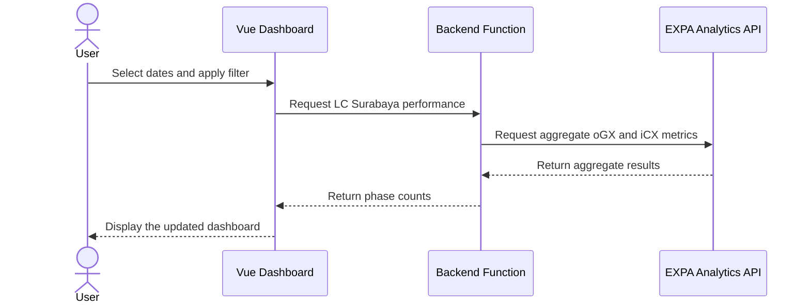

# LC Performance Dashboard

A one-page dashboard for reviewing the exchange performance of **AIESEC in Surabaya**. It shows outgoing exchange (oGX) and incoming exchange (iCX) side by side for a selected date range, with a downloadable CSV report.

Built for the **IID Web Development Technical Task**.

- [Live Dashboard](https://lc-performance-dashboard.netlify.app)
- [Performance Data Report (CSV)](https://drive.google.com/drive/folders/1uh50Tc35oxdM7iyQBbn1tWwexvMo2bX6?usp=sharing)

| File or folder | Contents | Technology |
| --- | --- | --- |
| [`src/App.vue`](src/App.vue) | Dashboard layout, date filters, funnels, charts, CSV export, and local fallback data | Vue 3, TypeScript, CSS |
| [`src/main.ts`](src/main.ts) | Frontend entry point | Vue 3 |
| [`netlify/functions/performance.mjs`](netlify/functions/performance.mjs) | Backend endpoint that serves simulated exchange data | JavaScript, Netlify Functions |
| [`public/`](public/) | Static assets, including the AIESEC logo | JPG |
| [`package.json`](package.json) | Dependencies and development scripts | npm, Vite |

> The dashboard uses simulated exchange figures for **1 October–26 November 2026**. The proposed live EXPA connection is documented in [Section 6](#6-expa-integration-plan).

## 1. Requirements

| Tool | Purpose |
| --- | --- |
| Node.js | Runs the Vite development server and production build |
| npm | Installs dependencies and runs project scripts |

## 2. Local setup

Run these commands from the project folder that contains `package.json`.

```bash
npm install
npm run dev
```

Open the **Local** URL printed in the terminal. The standalone Vite server uses the local demo dataset when the Netlify Function is unavailable. The demo requires no database or EXPA credential.

## 3. Using the dashboard

### 3.1 Filter and compare

Choose a date preset or set a custom start and end date, then click **Apply**. The summary cards, funnels, comparison table, and chart update together.

| Section | What it shows |
| --- | --- |
| Summary | Total sign-ups, applications, realized exchanges, and overall SU → CO conversion |
| Exchange funnels | Counts from **SU → APL → ACC → APD → RE → CO**, with conversion between adjacent phases |
| Comparison table | Phase counts and percentages of sign-ups for oGX and iCX |
| Performance over time | Application counts for oGX and iCX in daily or weekly groups |

### 3.2 Export the performance report

Click **Export Report** to download a CSV for the applied date range. The file includes the date range, phase labels, counts, and percentages of sign-ups for both exchange directions. Each row identifies the source as **Demo data**.

The default range is **1–26 November 2026**. It shows **706 sign-ups**, **358 applications**, **89 realized exchanges**, and **83 completed exchanges**. The overall SU → CO conversion is **11.8%**.

## 4. Maintenance

| What to update | Where to make the change |
| --- | --- |
| Backend demo counts and dates | Edit `periods` in `netlify/functions/performance.mjs`. |
| Local fallback data and coverage | Keep `demoRows`, `demoStart`, and `demoEnd` in `src/App.vue` in sync with the backend dataset. |
| Default date range and presets | Edit `ranges` in `src/App.vue`. |
| Phase labels and display order | Edit `phases` in `src/App.vue`. If a phase key changes, update the backend and fallback datasets too. |
| CSV fields and filename | Edit `exportReport()` in `src/App.vue`. |
| Logo | Replace `public/aiesec-logo.jpg`. |

### 4.1 Metric calculations

| Metric | Calculation |
| --- | --- |
| Funnel step conversion | Next phase count ÷ current phase count |
| Table percentage | Phase count ÷ sign-ups for that exchange direction |
| Overall SU → CO conversion | Total completed across oGX and iCX ÷ total sign-ups across oGX and iCX |

Percentages are rounded to one decimal place. A zero denominator appears as `—` on the dashboard.

## 5. Build and verification

Create the production build and preview it locally.

```bash
npm run build
npm run preview
```

The build output is generated in `dist/`. Use the [live dashboard](https://lc-performance-dashboard.netlify.app) to verify the deployed function.

| Check | Expected result |
| --- | --- |
| Open the dashboard | The default November range shows 706 sign-ups. |
| Select **Last month → Apply** | The October range shows 590 sign-ups. |
| Select **This year → Apply** | The available October and November data totals 1,296 sign-ups. |
| Switch from **Daily** to **Weekly** | The chart groups applications into seven-day periods. |
| Click **Export Report** after applying October | The CSV contains 1–31 October 2026 and columns for both oGX and iCX. |
| Open on a narrow screen | The funnels stack and the table and chart scroll within their sections. |
| Reload the live dashboard with **Network → Fetch/XHR** open | The `performance` request returns HTTP `200` with JSON containing `"source": "demo"` and `rows`. |

## 6. EXPA integration plan

The deployed Vue dashboard fetches simulated exchange data from `/.netlify/functions/performance`. If the function fails or returns an invalid response, the dashboard displays a notice and uses its local demo dataset.

For a live integration, the backend would request LC Surabaya’s aggregate oGX and iCX metrics for the selected dates, then return phase counts to the dashboard. The EXPA Analytics API is a candidate for retrieving those aggregates.



### 6.1 Credential handling

Store the EXPA credential in a server-side environment variable such as `EXPA_TOKEN`. The backend would use it for requests to EXPA and return only the aggregate data the dashboard needs. Keep the credential out of `VITE_` variables, frontend code, and Git commits.

## 7. Development issues

| Issue | How I handled it |
| --- | --- |
| The EXPA application query returned zero records during testing. | I confirmed that committee and opportunity queries returned data. I used a clearly labeled demo dataset to keep the dashboard testable and identified the aggregate Analytics API as a route to investigate for live data. |
| The initial line chart made daily oGX and iCX counts hard to compare. | I replaced it with grouped bars so both counts sit side by side for each day or week. |

## 8. Troubleshooting

| Symptom | What to check |
| --- | --- |
| `npm` cannot find `package.json` | Run the command from the project root. |
| The logo does not appear | Check that `public/aiesec-logo.jpg` exists. |
| Changing dates does not update the numbers | Click **Apply** to confirm the new date range. |
| **This year** and **Last 3 months** show the same totals | Both ranges include all available demo data, which covers October and November 2026. |
| The dashboard shows **No demo data for this range** | Select a range that overlaps 1 October–26 November 2026. |
| The dashboard shows **Demo API unavailable** | The dashboard is using its local fallback. On the live site, check the `performance` request in the browser’s Network panel. |
